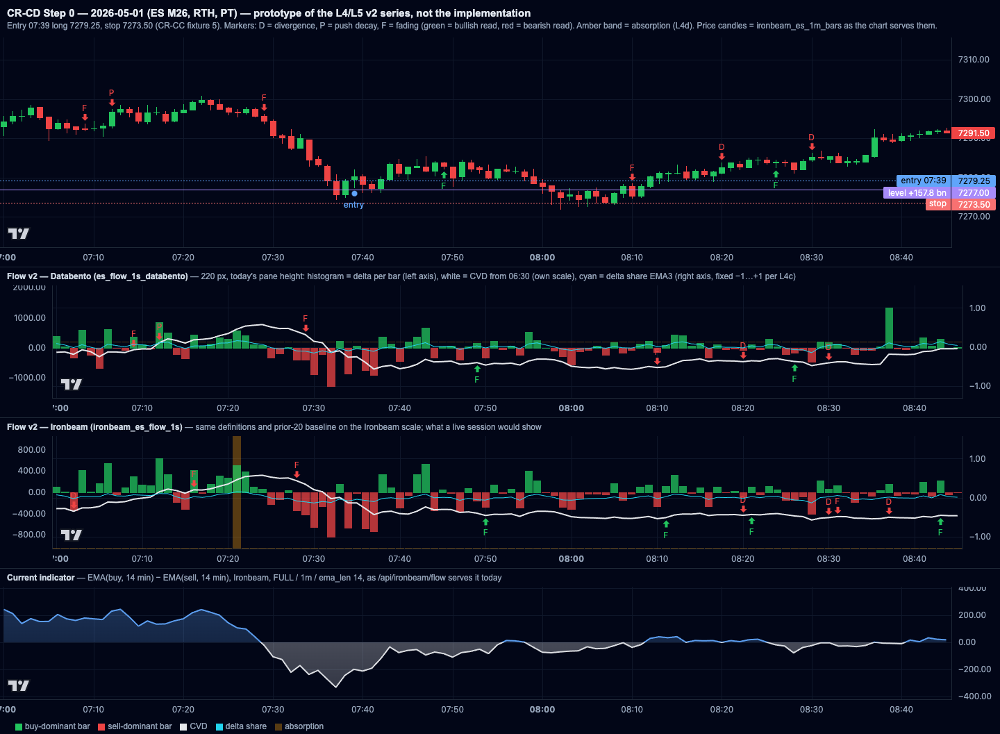

# CR-CD — Order Flow Pane v2

## Why

**Ryan (2026-10-25):** he doesn't know how to read the flow. All he has had is the current indicator, and he knows it isn't right. What the CR-CB tests calculate needs to be visible on the chart so he can see it and learn the read.

**The current pane** (`AggressorFlowPanel.jsx`, `/api/ironbeam/flow` via `_build_react_flow_payload` in `apps/web/modules/Ironbeam/callbacks.py`):
- it plots EMA(buy, 840 s) − EMA(sell, 840 s), a 14-minute-smoothed delta that mostly restates recent price direction;
- it reads `ironbeam_es_flow_1s`, which CR-CA measured at about 0.94× true volume and about 0.7× true buy − sell, with the worst gaps in busy minutes.

`es_flow_1s_databento` (CR-CA) now holds the accurate feed for 2024-04-03 → 2026-10-23, 06:15–13:00 PT.

## Locked decisions (Ryan to confirm before spec freeze)

| # | Decision | Value |
|---|---|---|
| L1 | Scope | A new flow pane mode **"Flow v2"** beside the existing indicator: a toggle "Flow: Current \| v2", **default Current**, remembered in localStorage (try/catch). With the toggle on Current, or without the new route parameter, `/api/ironbeam/flow` is byte-identical (golden test; CR-CC already recorded a flow golden). No table writes, no cron changes. |
| L2 | Data source | Per session: `es_flow_1s_databento` when it covers the session and window, otherwise `ironbeam_es_flow_1s`. Live sessions always use Ironbeam. The payload carries `source` (`databento` / `ironbeam`), and the pane shows it as a small badge. Contract from the data (CR-BZ L2). Ironbeam's ETH and post-13:00 PT data is used for those hours, since Databento covers only 06:15–13:00 PT. |
| L3 | Shared feature code | A new module `packages/shared/flow_features.py` holds the computations. CR-CB's scripts import it, so the pane shows exactly what is tested. If CR-CB's Step 0 code already defines these features, move it here unchanged and have CR-CB import it (no logic change; a test proves identical outputs on 3 sessions). |
| L4 | Series (v2) | All on 1-minute bars aligned to the price chart's bars, RTH-anchored (reset at 06:30 PT); ETH shown when the chart shows ETH, anchored at the 15:00 PT ETH open.<br>**(a) CVD:** cumulative (buy − sell), as a line.<br>**(b) Delta per bar:** buy − sell per minute, as a histogram (green/red).<br>**(c) Delta share:** (buy − sell) / volume, EMA over 3 bars, range −1…+1, as a line on its own scale.<br>**(d) Absorption band:** over a rolling 5 min, \|price move\| ÷ \|net aggressor volume\|, relative to the session's prior-20-session baseline (CR-BW L7 / CR-CB A5). Bars in the lowest 20 % of that ratio, with \|delta share\| ≥ 0.15, are shaded as "absorption" behind the histogram. |
| L5 | Markers (v2), computed causally (no lookahead) | **Divergence:** price makes a new 15-min low (high) while CVD's corresponding low (high) is higher (lower) by ≥ 10 % of the 15-min CVD range. **Push decay:** at a repeated test of a 30-min high or low, the push's delta is ≤ 0.6× the prior push's (CR-CB A5 PD logic). **Fading:** delta share's last-third vs first-third over the trailing 30 min crosses below 0 (CR-CB A5 LE logic). Each marker has a tooltip in plain English ("Sellers fading: price made a new low, but selling pressure was weaker than on the last low"). |
| L6 | Legend and help | A "?" in the pane opens a short guide: what each series means, how to read divergence and absorption against price, and the data-source caveat (live Ironbeam understates buy − sell by about 30 %, and the ratios are less affected). |
| L7 | Review mode | Respects CR-CC `until`: everything is truncated at the entry; markers after `until` are not drawn; all restored on reveal. |
| L8 | Layout | Same pane position and height as today. The v2 series stack inside it (histogram plus CVD on the left axis, delta share on a right axis). The pane gets a modest height increase only if Step 0 shows v2 is unreadable at the current height; Step 0 decides and reports it. No other visible change (CLAUDE.md visible-change discipline). |
| L9 | Performance | One session of v2 served in ≤ 1.5 s from a cold cache (Databento is about 23k rows per session). Cache per session for completed days. |

## Step 0 — diagnosis gate

1. **Current pane path:** where the frontend fetches and draws flow (`App.jsx` around lines 1326 and 1568, `AggressorFlowPanel.jsx`), and the smallest change that adds the v2 mode and toggle.
2. **Feature code:** whether CR-CB's Step 0 scripts define these features; propose the `flow_features.py` API; how equality with CR-CB will be proven.
3. **Source switching:** coverage checks for `es_flow_1s_databento` per session; behaviour at session boundaries and on days with ETH plus RTH.
4. **A worked day, 2026-05-01** (CR-CC fixture 5): v2 series and markers around the 07:39 entry and the 08:00 dip to about 7271–72, as a screenshot. Does divergence or absorption fire near the low?
5. **Byte-identity plan** for Current mode, and the payload shape for v2.

## Implementation order (one commit each)

1. `packages/shared/flow_features.py`, with unit tests on synthetic data (divergence, push decay, absorption, fading, and causality: no feature at t uses data after t).
2. Backend: a `mode=v2` parameter on `/api/ironbeam/flow` (source switching, series, markers, `until`); Current byte-identical.
3. Frontend: the toggle, the v2 rendering, tooltips and the "?" guide.
4. Smoke: 2026-05-01, 2026-04-01 and 2026-10-23 (the Ironbeam gap day, Databento-served), plus a live session if available; screenshots; Playwright toggle test.

**Deploy:** "Dash - MonoRepo".

## Kickoff prompt for Claude Code

```
Start CR-CD in its own git worktree: git fetch && git worktree add <scratch>/crcd-wt -b feat/CR-CD-order-flow-pane-v2 origin/main (confirm CR-CD is unused; rename if not). Another session runs CR-CB in its own worktree — do not touch it.
Read the vault CR "/Users/ryan/My Drive/Obsidian Vault/Anonymous/Dash/CRs/CR-CD — Order Flow Pane v2.md", components/field-conventions.md, specs/CR-CA-databento-es-flow-backfill.md, specs/CR-CC-setup-review-mode.md, specs/CR-BZ-live-tick-clean-minute-bars.md, and the CR-CB spec's A4/A5 flow-feature definitions.
Commit 1: spec freeze to specs/CR-CD-order-flow-pane-v2.md, verbatim. Commit 2: Step 0 findings (all five), with the 2026-05-01 screenshot. Read-only DB. Stop and report.
```

---

## Step 0 findings (2026-10-25, read-only)

Branch `feat/CR-CD-order-flow-pane-v2` off `origin/main` `578a8d5` (the CR-CC A2 merge, PR #80), in its own worktree. CR-CD was unused: no branch, no spec, no commit; only the vault note. The L1–L9 table is still marked "Ryan to confirm"; it was frozen as written, because the kickoff asked for the freeze. The CR-CB worktree was read and not modified.

**Method.**
- DB: `get_backfill_db_conn()` (role asserted) with `default_transaction_read_only = on` (asserted); SELECTs only.
- Coverage, gap and symbol counts run over every Databento date. These are mechanical checks, which CR-CA A3.3 allows on holdout rows.
- Everything value-based (the impact scale, the worked day and its 20-session baseline) reads train only: before 2026-06-05 21:00 UTC.
- Scripts are under `scripts/cr_cd_step0/` (`q3_sources.py`, `q4_worked_day.py`, `render_page.py`, `shot.mjs`).
- The existing flow goldens pass on this base: `test_until_replay` 11/11.
- No code outside `scripts/cr_cd_step0/` and `specs/` was changed.

**Verdict: no stop. Ten decisions are needed before implementation (end of this section).** The ones that change the design most:
- **D1.** Serving Databento for 2026-06-05 → 10-23 puts holdout flow in front of Ryan's eye.
- **D2.** L4/L5 as written are rolling analogues of CR-CB's features, not the same features.
- **D3.** L5's markers fire about 31 times a session on 2026-05-01, and none fires at the 08:02 low.
- **D5.** In roll weeks, the "dominant" Databento contract is not the contract the chart's candles show.

### Q1 — Current pane path, and the smallest change for v2

**Fetch (`react_price_preview/src/App.jsx`).**
- Historical load, `useEffect` at `:1307–1385`: one `GET /api/ironbeam/flow` per loaded session (`loadedFlowDates`, `:1107`, i.e. the centre date plus any `days_either_side` extras), with `session` (URL `flow_session`, default `FULL`), `resample` (default `1m`), `ema_len` (from the EMA-minutes setting) and, during a CR-CC replay, `until`. Responses are merged into `flowPoints` (`{time, value}`).
- Live poll, `useEffect` at `:1555–1600`: every `FLOW_LIVE_POLL_MS` = 3 s while `isLiveTradeDate`, the same request for the selected session; a changed signature replaces that session's points.
- Mount, `:2081–2108`: `<div className="react-bottom-pane">` sized `flowPanelHeight` (user-resizable 140–520 px, default 220, stored in `ib-react-flow-panel-height`), holding `<AggressorFlowPanel dataPoints={flowPoints} candles={mergedBarsWithLiveTimeline} visibleLogicalRange={sharedLogicalRange} …/>`.

**Draw (`components/AggressorFlowPanel.jsx`, 746 lines).**
- One lightweight-charts 5 chart: a `BaselineSeries` around 0 (blue above, grey below) plus a zero `LineSeries`. Header: a ⚙ settings button (EMA minutes) and the title "Aggressor Flow".
- **Time alignment is by logical index, not by time.** `bucketFlowToCandles` (`:128`) emits exactly one point per candle time (mean of the flow points in that bucket, or a whitespace point), and the chart follows the price chart's `visibleLogicalRange`. Any v2 series must also emit one entry per candle time, in the same order, or the panes drift apart. The candles include the live timeline (`mergedBarsWithLiveTimeline`) and are 1-min or 5-min (`interval` URL parameter, `:463`).

**Backend.** `/api/ironbeam/flow` (`apps/web/modules/Ironbeam/callbacks.py:3079`) → `_build_react_flow_payload` (`:1585`): resolves the contract (`_resolve_symbol`, CR-BZ L2), reads `ironbeam_es_flow_1s` only (`FLOW_TABLE_NAME`, `:98`), reindexes to every second of the view window (RTH 06:30–13:00 or FULL = prior 15:00 → 13:00 PT, `_session_window_pt`, `:684`), resamples, and returns `EMA(buy) − EMA(sell)`.

**Smallest change for v2.**
1. Backend: branch at the route on `mode`. `mode=v2` calls a new `_build_react_flow_v2_payload`; any other value (absent, empty, `current`, unknown) calls `_build_react_flow_payload` unchanged. No line inside the existing builder changes.
2. Frontend state: `flowMode` (`'current' | 'v2'`), seeded from `localStorage['ib-react-flow-mode']` in a try/catch (same pattern as `FLOW_HEIGHT_STORAGE_KEY`), default `'current'`. Both fetch effects add `mode=v2` and store the v2 payload in its own state (`flowV2`), merged per session; `flowPoints` is untouched in Current mode.
3. Frontend render: a new `AggressorFlowV2Panel.jsx` mounted in the same `react-bottom-pane` div when the mode is v2, rather than branching inside `AggressorFlowPanel`. It copies the panel's logical-range sync, crosshair link and session bands, and aligns every series to `candles` one-to-one. The toggle ("Flow: Current | v2") sits in both panels' headers, next to ⚙. In Current mode the only visible change is that toggle (L1 asks for it).
4. Interval: L4 is defined on 1-min bars. On a 5-min chart the server's 1-min values are aggregated client-side per candle (delta and volume summed, CVD = last, share recomputed from the sums, absorption = any absorbing minute, markers snapped to their bucket). See D6.
5. Live: the 3 s poll would recompute the whole session server-side each time (Q3, L9). See D7.

### Q2 — Feature code: where CR-CB's features are, the `flow_features.py` API, and the equality proof

**What CR-CB has.** CR-CB's flow features are in `scripts/cr_cb_step0_v2.py` in the CR-CB worktree (`feat/CR-CB-failed-retest-at-level`, head `8aebb52`). The file is **untracked** there (work in progress; sha256 `954c7dee…22b522` at the time of reading) and was read, not touched. It executes DB work at import (module-level loads), so it cannot be imported by a test. The relevant code:
- `flow_sum(F, t0, t1)`: net aggressor and volume over [t0, t1) on 1-second flow arrays `F = {t, buy, sell, vol, o, h, l, c}`.
- `windows` / `sess_stats` → per-session lists, then **B_d** = median over the prior ≥ 5 (≤ 20) usable sessions of `sign(net)·Δclose / (|net|/1000)` over non-overlapping RTH 300 s windows with no flow gap > 15 s (`BASE_N 20, BASE_MIN 5, BASE_W 300, GAP_MAX 15`). This is a **signed** impact median.
- `edge_features(F, d, e, a, edge)`: at one A4 edge event, `P` (net over the 120 s before the touch, `PUSH_W 120`), `A_rel`, `Q`, pushes (within `tol` of the edge, a push ends after a retreat of more than `tol + 2` pts, `RETREAT 2`), **PD** = OLS slope of push P on push index ÷ mean P (≥ 2 pushes), **LE** = delta share of the last third of [confirmation, touch] − the first third, **RA** = (move toward the edge / (net/1000)) ÷ B_d, **DV** = net / volume over the range, SS share / SS VWAP; then the skew readouts.
- `rules(E)`: FR1–FR12 on per-cell tercile cuts of Stage 1 events.

**What does not carry over one-to-one to the pane.** CR-CB's features are **event-anchored** (a confirmed range at a level, an edge touch) on 1-second flow. L4/L5 are **rolling, level-free** on 1-minute bars. Three of the L4/L5 definitions also differ from CR-CB's on substance:

| pane (L4/L5) | CR-CB | difference |
|---|---|---|
| L4(d) absorption: \|move\| ÷ \|net\| over a rolling 5 min, lowest 20 % | RA: signed (toward the edge) move ÷ net over the range, ÷ B_d (a signed median) | absolute vs signed ratio; rolling 5 min vs range-long; a fixed 20 % cut vs Stage 1 terciles |
| L5 push decay: this push's delta ≤ 0.6 × the previous push's | PD: slope of push P across all pushes ÷ mean P | pairwise ratio vs slope; threshold 0.6 vs sign / tercile |
| L5 fading: last-third − first-third share over the trailing 30 min crosses below 0 | LE: same construction over [confirmation, touch], used by tercile | trailing 30 min vs the range; the sign needs a reference side (D3) |

So "the pane shows exactly what is tested" holds for the **primitives** (net, delta share, push segmentation, the impact baseline B_d and its gap rule) but not for the markers as L5 words them. See D2.

**Proposed API** (`packages/shared/flow_features.py`, numpy/pandas only, no DB):

```python
# primitives — moved from cr_cb_step0_v2.py unchanged (names and arithmetic)
flow_sum(F, t0, t1) -> (net, vol, a, b)
impact_windows(F, rth_open_epoch, n=78, width=300, gap_max=15) -> Iterator[(a, b)]
session_impact_samples(F, rth_open_epoch) -> (abs_dclose, signed_impact, abs_impact)
impact_baseline(samples_by_session, session, n=20, min_n=5) -> {"B_d", "abs_median", "abs_p20", "n_sessions"}
pushes(hi, lo, t, start_i, end_i, edge_px, tol, retreat, edge) -> list[int]      # push start indices
push_decay(push_nets) -> float | nan                                               # PD (slope / mean)
late_vs_early(F, t0, t1, sign) -> float | nan                                      # LE
range_absorption(...) / range_divergence(...)                                      # RA, DV

# pane — rolling, causal, 1-minute
minute_frame(F, start_epoch, end_epoch, bar_starts) -> DataFrame[o, h, l, c, buy, sell, vol]
cvd(m, anchor_epoch) / delta(m) / delta_share(m, span=3)
absorption(m, baseline, window=5, cut=0.20, min_share=0.15) -> DataFrame[imp_rel, absorb]
divergence_markers(m, window=15, frac=0.10, debounce=5) -> list[Marker]
push_decay_markers(m, window=30, tol=1.0, retreat=2.0, ratio=0.6) -> list[Marker]
fading_markers(m, window=30, debounce=10) -> list[Marker]
```

**Equality proof.** The CR-CD session must not touch the CR-CB worktree, so the move is one-way:
1. CR-CD copies the primitives from the CR-CB file at the sha above, unchanged, into `flow_features.py`, and vendors the CR-CB function bodies as a frozen test oracle (`tests/cr_cb_oracle.py`, with the source sha in its docstring).
2. A test records 1-second flow for 3 train sessions (2026-01-06, 2026-03-02, 2026-05-01; Databento) into a fixture and asserts that `flow_features` and the oracle return identical values (`==`, not `isclose`) for B_d and for `P`, pushes, PD, LE, RA, DV on synthetic edge events placed on those sessions.
3. CR-CB then imports `flow_features` in its own session (a CR-CB commit, Ryan's call), and its Step 0 JSON must be unchanged. That last check belongs to CR-CB.


### Q3 — Source switching: coverage, boundaries, ETH + RTH

**`es_flow_1s_databento` coverage** (`q3_sources.py`):
- 643 sessions, 2024-04-03 → 2026-10-23. Every session starts at 06:15 PT.
- The dominant contract runs to 12:59:59 on 627 sessions. Early closes end at 10:14 (6 sessions).
- Two contracts are stored on 96 sessions (the CR-CA L3 roll spans).
- **RTH feed gaps (dominant contract):** median of the per-session max gap 7 s, p95 12 s, max 17 s. Max gap > 15 s on 4 sessions (2024-10-14, 2024-12-16, 2025-08-18, 2026-08-12, 16–17 s each); none > 60 s.
- Ironbeam for comparison: 78 of 212 sessions > 15 s, 40 > 60 s (the CR-BZ trades-ws stalls).
- **Databento has a gap-free RTH on every session; Ironbeam does not.**
- **Measurement artifact (not a data issue):** on the 10 quarterly-expiry days, the script's dominant pick fell on the expiring contract, whose last row is 06:29 PT (it stops at the 06:30 SOQ). Its RTH volume is NULL and sorted last. The correct pick on those days is the new contract. The disagreement list below is read with this in mind (2026-03-20, 06-18, 09-18).

**`ironbeam_es_flow_1s` coverage:**
- Starts 2025-12-26 18:20 UTC, all hours; last date 2026-10-23 at the time of reading.
- No Ironbeam RTH rows on 2026-03-03 (no flow), 2026-03-20 and 2026-09-18. These are expiry days: Ironbeam's contract had expired at the open and it had not rolled yet.
- So for 2024-04-03 → 2025-12-25 **there is no ETH flow at all**. v2 can show RTH only on those sessions (D10).
- Databento ends 2026-10-23 and has no ongoing feed. **Every session from 2026-10-26 on is Ironbeam**, live or not, so a multi-day view across that date mixes scales.

**Same contract? Dominant RTH contract, Databento vs Ironbeam, on the 205 sessions both cover:**
- They differ on 9 sessions:
  - 2026-03-16..19: Databento M26, Ironbeam H26;
  - 2026-09-14..17: Databento Z26, Ironbeam U26;
  - 2026-06-18: the expiry artifact.
- Ironbeam rolls after expiry (2026-03-23); Databento's volume rolls in the week before.

**Which contract do the chart's candles show?** On the 96 two-contract sessions, minute closes of each Databento contract were compared with `ironbeam_es_1m_bars`:
- One contract matches the bars on every session (best match: median 1.000, min 0.926; no session below 0.9).
- **That contract is not the RTH-volume-dominant one on 33 sessions.** Every roll week in 2024–2025 is one of them: the 2024–2025 bars are `ES.c.0` calendar-roll, so they show the dying contract (CR-CA Q4). So are 2026-03-16..19 (H26) and 2026-06-18.
- 2026-09-14..17 match Z26, because CR-BF patched those bars to Z26.
- So "contract from the data" (CR-BZ L2, by volume) would draw the new contract's flow under the old contract's candles on those days. Within the flow this is consistent, because v2 computes price features from the flow's own prices. But a divergence marker could then sit at a candle low that is not the flow's low. See D5.

**Scale, Ironbeam vs Databento** (train sessions 2026-01-06 → 06-05, n 102, RTH 5-min buckets, dominant contract per table):

| measure | Ironbeam ÷ Databento |
|---|---|
| \|Δprice\| ÷ \|net\| per 5 min (L4d's ratio), per-session median | **1.29** (p10 1.10, p90 1.53) |
| signed impact (CR-CB B_d's ratio) | 1.17 (p10 0.92, p90 1.52) |
| net per 5 min (slope) | 0.70 |
| delta share per 5 min | slope **0.80**, corr 0.90 |

- L6's caveat "the ratios are less affected" holds only partly.
- Delta share is 0.8× on Ironbeam. L4(d)'s impact ratio is about 1.3× higher, because the denominator is undercounted.
- So the absorption baseline must come from the **same source as the session it is applied to**. Prior-20 Ironbeam sessions exist from about 2026-01-26. Carrying a Databento baseline to a live Ironbeam session would shift the 20 % cut by about 30 %.

**Session boundaries and ETH + RTH.**
- The chart's FULL window is the prior day 15:00 → 13:00 PT (`_session_window_pt`). It contains no 13:00–14:00 PT data, so L2's "post-13:00 PT" Ironbeam case never arises in this pane.
- Proposed: two segments per session, each from a single source.
  - **ETH** 15:00 → 06:30 from Ironbeam, CVD anchored at 15:00.
  - **RTH** 06:30 → 13:00 from Databento when covered (else Ironbeam), CVD anchored at 06:30.
- The 06:15–06:30 Databento rows are not drawn. They serve only as warm-up for RTH look-back windows (the first 5-min absorption window, the 15/30-min marker windows) so markers are defined from 06:30. Whether marker windows may look back into ETH is D3.
- With `days_either_side`, each session is its own request and its own anchors, as today.
- The payload carries `source` per segment, and `source` at the top level (the RTH segment's) for the badge.

**Performance (L9).**
- One session of 1-second rows, contract + `ts_utc` range (PK): 22,153 rows in 0.09–0.32 s (Databento), 0.09–0.11 s (Ironbeam).
- The 20-session baseline is the cost. As per-second rows with a PT time-of-day filter it took 2.2 s (Databento) and **14.1 s** (Ironbeam, an all-hours table).
- The prototype's per-minute SQL took about 3 minutes for 2 × 21 sessions. It filters on `(ts_utc AT TIME ZONE …)::date`, a function predicate that forces a scan of the whole table.
- So L9 is met only if:
  - (a) every read is a `ts_utc` range on the PK, per session;
  - (b) the baseline's per-session impact samples are aggregated in SQL to 5-min buckets (about 78 rows per session);
  - (c) they are cached in-process per completed session (L1 allows no table writes).
- Cold first request ≈ 1 session fetch + 20 small aggregate queries, to be measured in implementation step 2.
- Live: the 3 s poll recomputing the whole session (D7).

### Q4 — Worked day 2026-05-01 (CR-CC fixture 5, train)

**Inputs.**
- ES M26 (both sources).
- Baseline: the prior 20 sessions, 2026-04-02 → 04-30, same source. Databento \|Δp\|/\|net\| median 4.55, p20 1.94; Ironbeam 6.22 / 2.42.
- Candidate (gallery): level 7277.00 (+157.8 $bn), test 07:37, extreme 7274.50, entry 07:39 long 7279.25, stop 7273.50.
- Its outcome was already revealed in CR-CC (stop −5.75). The prototype does not use it.

**Prototype readings of L4/L5** (proposals, `q4_worked_day.py`; every value at bar t uses bars ≤ t):
- delta share = EMA(span 3) of per-minute (buy − sell)/volume;
- absorption = rolling 5-min \|Δclose\|/(\|net\|/1000), flagged when ≤ the prior-20 pooled p20 and \|delta share\| ≥ 0.15;
- divergence = new 15-min low (high) at bar t, with CVD at t ≥ (≤) CVD at the window's prior low (high) bar ± 10 % of the 15-min CVD range, 5-bar debounce;
- push decay = first bar within 1 pt of the trailing 30-min high/low after a retreat of more than 3 pts, push delta = net of the 2 bars before it, marker when ≤ 0.6 × the previous push (previous > 0, ≤ 30 min ago);
- fading = dominant side over the trailing 30 bars, its last-10 minus first-10 delta share crossing below 0, 10-bar debounce.

**Screenshots** (prototype drawn with lightweight-charts 5.1.0, the pane's library; v2 panes at 190 px of chart plus header, about today's 220 px pane):
- `specs/assets/cr-cd/step0-2026-05-01-0700-0845.png`: 07:00–08:45;
- `specs/assets/cr-cd/step0-2026-05-01-rth.png`: 06:30–13:00.

From top: candles with level / entry / stop lines and the Databento markers; v2 on Databento; v2 on Ironbeam; the current indicator (FULL / 1m / ema_len 14, computed exactly as the route does).



**What fires near the entry and the 08:00 dip** (session low to 08:30 is 7272.00 at 08:02; the 07:37 test low is 7274.50):

| time | Databento | Ironbeam |
|---|---|---|
| 07:21 | — | absorption (1 bar) |
| 07:28–07:29 | fading, buyers | fading, buyers |
| 07:49–07:50 | **fading, sellers** (bullish read, 12 min before the low) | **fading, sellers** |
| 08:01–08:04 (the low) | **nothing** | **nothing** |
| 08:10–08:11 | fading, **buyers** | fading, **sellers** |
| 08:20 | divergence, bearish (new 15-min high) | divergence, bearish |

- **Divergence does not fire at the low under L5 as written.** In a falling sequence the 15-min window's prior low is usually the previous bar, so "CVD's corresponding low" is one minute earlier. At 08:01 Databento CVD is 8,169 vs 8,299 at 08:00 (lower), so there is no divergence.
- **Against the 07:37 swing low (25 min earlier, outside the 15-min window)**, the read the setup implies:
  - Databento CVD at 08:02 is **+187 higher** (8,100 vs 7,913): a bullish divergence, but only 7.7 % of the 30-min CVD range (2,428), below L5's 10 %.
  - Ironbeam CVD is **−379 lower** (5,767 vs 6,146, −15 %): no divergence; selling confirmed the low.
  - **The two sources disagree on the sign** of the one divergence that matters on this day. This is the 0.7× delta undercount at work (CR-CA), and it is exactly the live case.
- **Absorption does not fire near the low on either source.** Relative impact 07:55–08:09 is 0.2–2.2× the baseline median, mostly ≈ 1: price moved about as far as the volume would predict. On Databento all 12 absorption bars fall in 10:35–12:58.
- **Volume.** Databento has 31 markers in the session (16 fading, 13 divergence, 2 push decay); Ironbeam 36 (18 / 17 / 1). Several pairs fire minutes apart in opposite directions (06:50 bull / 06:51 bear divergence on both sources).
  - At this density the markers do not teach a read, so D3 proposes fewer, stricter markers.
  - Push decay fired only twice. Its text needs work: "push had −88 net vs +548" is signed toward the edge and reads as a sign flip.
- **Delta share** \|value\| p50 0.055, p90 0.145, max 0.25 (Databento). On L4(c)'s fixed −1…+1 axis it is a near-flat line (D8). The absorption gate \|share\| ≥ 0.15 admits only the top ~10 % of bars.
- **The current indicator** at entry read −200 (the 14-min EMA still remembered the 07:28–07:37 selling). It crossed above 0 at 07:56 and was −77 at the 08:01 stop print. It restates the last 15 minutes of price direction, as the CR's Why says.

**L8 — height.** At 220 px the 07:00–08:45 view is readable: histogram, CVD and markers are distinct. Over a full session the v2 pane is cluttered by marker count, not by height. **Step 0's call: no height change.** The pane is already user-resizable (140–520 px, persisted), so L8's "modest increase" is not needed; marker density is the fix (D3).

### Q5 — Byte identity for Current mode, and the v2 payload

**Byte identity.**
- Goldens exist: `apps/web/modules/Ironbeam/tests/fixtures/cr_cc_flow_golden_{full,rth}.json`, recorded from the pre-CR-CC module (2026-10-23, FULL 1m and RTH 15s), replayed through `flow_fixture.py` (DB reads `_resolve_symbol`, `_fetch_flow_utc` served from `cr_cc_flow_2026-10-23.pkl.gz`). On this base (`578a8d5`) `test_until_replay` passes 11/11, including the flow goldens.
- Plan: extend the suffix loop in `test_flow_matches_cr_cc_golden` with `&mode=`, `&mode=current`, `&mode=CURRENT`, `&mode=bogus`; each must equal the golden bytes. Plus a guard test that `_build_react_flow_payload`'s source is unchanged (hash of `inspect.getsource`), so a v2 refactor cannot leak into it.
- `mode=v2` gets its own record/replay fixture (DB reads go through two new functions, `_fetch_flow_rows(table, …)` and `_fetch_impact_baseline(…)`, so they can be recorded) and its own golden for 2026-05-01.

**v2 payload (proposed).**

```json
{
  "mode": "v2",
  "trade_date": "2026-05-01", "effective_trade_date": "2026-05-01", "session": "FULL",
  "until": "2026-05-01T07:39:00",                    // only in replay (CR-CC L5)
  "source": "databento",                              // the RTH segment's source: the badge
  "segments": [
    {"name": "eth", "source": "ironbeam",  "symbol": "XCME:ES.M26", "anchor": "2026-04-30T15:00:00", "start": …, "end": …},
    {"name": "rth", "source": "databento", "symbol": "XCME:ES.M26", "raw_symbol": "ESM6", "anchor": "2026-05-01T06:30:00", "start": …, "end": …}
  ],
  "baseline": {"source": "databento", "sessions": ["2026-04-02", "2026-04-30"], "n_sessions": 20,
               "abs_median": 4.55, "abs_p20": 1.94},
  "bars": [{"time": 1777642200, "seg": "rth", "buy": …, "sell": …, "vol": …, "delta": …, "cvd": …,
            "share": …, "imp_rel": …, "absorb": false}],
  "markers": [{"time": …, "kind": "divergence|push_decay|fading", "side": "bull|bear", "text": "…", "detail": {…}}],
  "gaps": [{"start": …, "end": …, "seconds": …}],    // feed holes > 15 s, greyed in the pane
  "symbol_note": null, "notes": []
}
```

- `time` = bar start, UTC epoch seconds (the same convention as `flow_points`; the frontend shifts to PT display).
- One `bars` entry per minute of each segment, including zero-volume minutes; a segment has no entry for minutes where its source has no coverage at all (the frontend fills whitespace per candle).
- Markers carry only bars ≤ their own time (causal); under `until`, bars and markers with time ≥ `until` are absent (L7).

### Decisions needed (before implementation)

1. **D1 — Holdout in the pane.** CR-CA loaded Databento through 2026-10-23, and field-conventions marks rows after 2026-06-05 as holdout, "not to be read without a pre-registration". L2 would show that flow on the chart, and step 4's smoke names 2026-10-23. Options:
   - (a) the pane serves Databento only through 2026-06-05 and Ironbeam after (recommended: the eye is also a reader);
   - (b) allow it and record that Ryan has seen the holdout flow.
2. **D2 — "The pane shows exactly what is tested."** True for the primitives only (Q2). Recommended:
   - `flow_features.py` holds CR-CB's primitives unchanged (`flow_sum`, the B_d baseline, push segmentation, LE/RA/DV) with the oracle test;
   - the pane's rolling series and markers are built on those primitives and labelled in the "?" guide as rolling analogues, not CR-CB's event features.
   - CR-CB adopts the import in its own session.
   - Alternative: draw CR-CB's own edge events and rule decisions (needs its detector and levels in the web service; much larger).
3. **D3 — Marker definitions and density.** Proposed amendments, to be checked against 2026-05-01 / 04-01 / 03-02 before freezing:
   - divergence against the **prior swing low/high within 30 min** that is at least 5 bars back (not the previous bar), keeping the 10 % rule;
   - fading: either drop it as a marker (it becomes a sub-line in the "?" guide), or require the dominant side's 30-min share \|·\| ≥ 0.10 first;
   - a cap of one marker of a kind per 15 min;
   - marker look-back windows do not reach into ETH;
   - push-decay text in plain words ("Buyers' push into the high: 92 contracts, vs 1,009 on the last push").
4. **D4 — Absorption definition.**
   - (a) L4(d)'s **absolute** ratio vs CR-CB's **signed** B_d.
   - (b) "Lowest 20 %" read as ≤ the p20 of the prior-20 sessions' rolling 5-min ratios, pooled (the prototype's reading).
   - (c) The share gate uses the EMA-3 series (as prototyped) or the 5-min window's own share.
   - (d) The baseline is always from the session's own source (Q3 scale 1.29×).
5. **D5 — Contract in two-contract sessions.** Recommended:
   - pick the Databento contract whose minute closes match the chart's bars (≥ 0.9; one does on all 96 sessions), falling back to RTH volume when no bars exist;
   - flow, price features and candles are then one contract, and the badge names it.
   - Alternative: CR-BZ L2's volume rule, which puts the new contract's flow under the old contract's candles on 33 sessions.
6. **D6 — 5-min charts.** Aggregate the 1-min v2 per candle client-side (Q1, point 4). Alternative: v2 disabled on 5-min with a note.
7. **D7 — Live cadence.** v2 live poll every 15 s (not 3 s), the server recomputing only the last 30 min's markers on cached minutes. Today's 3 s poll stays for Current.
8. **D8 — Delta-share axis.** L4(c)'s fixed −1…+1 flattens a series whose p90 is 0.15. Proposed: symmetric autoscale, or fixed ±0.3 with gridlines at ±0.15 (the absorption gate).
9. **D9 — Performance design (L9).** Per-session `ts_utc` range reads only; baseline samples aggregated in SQL and cached in-process per completed session; no new tables (L1). To be measured cold in implementation step 2.
10. **D10 — No ETH flow before 2025-12-26.** v2 shows the RTH segment only on 2024-04-03 → 2025-12-25, with a note in the pane, rather than mixing a different source into ETH.

---

## Amendment A1 (Ryan, 2026-10-25, after Step 0)

The Step 0 recommendations for D1–D10 are accepted, with these specifics. L1–L9 stand except where a clause below says otherwise.

| # | Clause |
|---|---|
| A1.1 (D1) | **Holdout protection.** Databento (`es_flow_1s_databento`) is served only for sessions ≤ 2026-06-05; Ironbeam for every later session. The pane's badge shows the source. |
| A1.2 (D2) | `packages/shared/flow_features.py` holds the **shared building blocks only**: net volume, delta share, push detection and the impact baseline, copied unchanged from CR-CB, with an identity test. The pane's markers are labelled **visual aids**, not the CR-CB test features. |
| A1.3 (D3) | **Markers are OFF by default**, with a toggle in the pane.<br>• **Divergence** is measured against the **last confirmed swing low/high** (a swing is confirmed by a ≥ 4-pt retrace), not the previous bar.<br>• **Push decay** fires only at repeated tests (within 2 pts) of the same swing.<br>• **Fading** is unchanged.<br>Target: a handful per session. The smoke reports the per-session marker count on 3 days. |
| A1.4 (D5) | In two-contract sessions, use the contract that **matches the chart's bars**. |
| A1.5 (colours) | Use the Dash's existing palette constants: the current flow pane's positive/negative colours and the candle up/down colours (**blue for buying, light grey for selling**). Absorption shading in a neutral, translucent tone. **No green/red.** |
| A1.6 | Height unchanged. The 20-session baseline is SQL-aggregated and cached. D4 and D6–D10 as recommended. |
| A1.7 | **Source caveat**, in the spec and the "?" guide: on live (Ironbeam) data, CVD divergence can disagree in sign with Databento (2026-05-01: at the 08:02 low, Databento CVD +187 vs the 07:37 low, Ironbeam −379). Ratio measures are more robust. |
| A1.8 (sequence) | Implement steps 1–4, one commit each; Current mode byte-identical. Push, open a PR (deploy = "Dash - MonoRepo"), do not merge. Screenshots on 2026-05-01, 2026-04-01 and one other train day. |

### A1 operational readings (Claude Code, fixed before implementation)

These are written down here so the implementation can be checked against them.
- **Swing (A1.3).** In the RTH segment, a swing low at bar k is **confirmed** at the first later bar whose high is ≥ low_k + 4 pts, where low_k is the running low since the previous confirmed swing low. Mirror for highs. A swing is usable only from its confirmation bar onward (causal).
- **Divergence.**
  - Bullish at bar t: low_t < the last confirmed swing low, and CVD_t ≥ CVD at the swing bar + 10 % of the CVD range over [swing bar, t]. Mirror for bearish.
  - At most one divergence per swing.
- **Push decay.**
  - A test of the last confirmed swing high is the first bar of an approach with high ≥ swing − 2 pts, after price has retreated more than 4 pts (2 + CR-CB's 2-pt retreat) below the swing since the previous test.
  - The swing is dropped once a bar trades more than 2 pts beyond it.
  - Push delta = net aggressor volume in the 2 bars before the test bar, signed toward the swing (CR-CB's 120 s push window at 1-minute resolution).
  - The marker fires when push delta ≤ 0.6 × the previous test's push delta, and that previous delta is > 0. Mirror for lows.
- **Fading.** As in L5 and Step 0: over the trailing 30 bars, the dominant side's delta share in the last 10 bars minus the first 10 crosses below 0. The D3 cap applies: at most one marker of a kind per 15 min.
- **Absorption (D4 as recommended).**
  - Ratio: rolling 5-min |Δclose| ÷ (|net| / 1000).
  - Flagged when the ratio is ≤ the p20 of the prior-20 sessions' rolling ratios (pooled, same source), and |delta share (EMA 3)| ≥ 0.15.
- **ETH (D10).** The ETH segment shows delta, CVD and delta share only. Absorption and markers are RTH-only, because the baseline is RTH. Marker windows never reach into ETH.
- **Delta-share axis (D8).** Symmetric autoscale, with reference lines at ±0.15.

## Amendment A2 (Ryan, 2026-10-25, during step 1) — marker settings

**Context.** The A1.3 definitions, implemented as written, give 33 / 48 / 42 markers per session on 2026-01-06 / 03-02 / 05-01 (Databento, RTH). The target was "a handful". Measured alternatives (markers per session, 01-06 | 03-02 | 05-01):

| setting | markers |
|---|---|
| A — A1 as written | 33 \| 48 \| 42 |
| B — swing retrace 8 pts | 22 \| 35 \| 25 |
| C — one per kind per 30 min | 21 \| 30 \| 27 |
| D — floors: previous push ≥ 500, divergence ΔCVD ≥ 300, fading only when the dominant side's 30-min \|share\| ≥ 0.10 | 9 \| 20 \| 19 |
| E — B + D | 2 \| 11 \| 7 |
| **F — B + C + D** | **2 \| 7 \| 7** |

| # | Clause |
|---|---|
| A2.1 | **Ryan's ruling: the marker settings are settable in the pane.** Defaults = **F**: swing retrace 8 pts, previous push > 500, divergence ΔCVD ≥ 300 (and ≥ 10 % of the CVD range), fading only when the dominant side's trailing 30-min \|delta share\| ≥ 0.10, at most one marker of a kind per 30 min. A small markers-settings dialog in the pane edits these five values; they persist in localStorage (try/catch) and are sent to the server as query parameters. A1 as written stays reachable by setting 4 / 0 / 0 / 0 / 15. |
| A2.2 | The test band (2 pts), the 0.6 push ratio, the 10 % divergence fraction and the fading construction are unchanged. |
| A2.3 | The smoke reports per-session marker counts for the defaults and for A1 as written. |

---

## Implementation and smoke (2026-10-25)

Branch `feat/CR-CD-order-flow-pane-v2`, off `origin/main` `578a8d5`.

| step | commit | what |
|---|---|---|
| A1 | `a25dea4` | Amendment A1 (spec and vault note) |
| A2 | `c473bc5` | Amendment A2: marker settings settable in the pane, defaults F |
| 1 | `782298c` | `packages/shared/flow_features.py`. Part A: CR-CB building blocks, identity-tested. Part B: pane series and markers. 13 tests |
| 2 | `d37daf6` | `/api/ironbeam/flow?mode=v2` (`apps/web/modules/Ironbeam/flow_v2.py`), route branch in `callbacks.py`. 9 tests; Ironbeam suite 63/63 |
| 3 | `5fa18c8` | Frontend: toggle, `AggressorFlowV2Panel.jsx`, marker settings, guide |
| 4 | (this commit) | Smoke backend, Playwright, screenshots, counts, this section |

### Step 1 — shared building blocks (A1.2)

- **Copied unchanged** from `cr_cb_step0_v2.py` (sha256 `954c7dee…`): `flow_sum`, `max_gap`, the impact windows and samples, the B_d / σ5 baseline, push detection, push decay (PD), and the edge features P, A_rel, Q, LE, RA, DV, SS. CR-CB's module globals became parameters.
- **Identity test** against a verbatim excerpt of the CR-CB file (`packages/shared/tests/fixtures/cr_cb_step0_v2_excerpt.py.txt`, executed as an oracle). Outputs are equal (`==`) on:
  - 3 recorded Databento sessions (2026-01-06, 03-02, 05-01) and 8 synthetic ones;
  - 72 edge events;
  - every session's baseline.
- **CR-CB still runs its own copy.** Switching CR-CB to import `flow_features` is CR-CB's step; its Step 0 JSON should then be unchanged.
- **Pane functions** take a `MarkerParams` per call: the web service handles concurrent requests, so the settings cannot be module globals. A causality test on 2026-05-01 checks that series and markers computed on any prefix equal the full-session result cut at that time, for both the defaults and A1 as written.

### Step 2 — backend

- **Current mode is unchanged.**
  - `mode` absent, empty, `current`, `CURRENT`, `bogus` or `v1`, and the `m_*` parameters without `mode=v2`: all equal the CR-CC flow goldens byte for byte.
  - A test pins the sha256 of `_build_react_flow_payload`'s source to its value at `578a8d5`.
- **Reads.** Two functions, `fetch_flow_minutes` and `fetch_bar_closes`. Rows are aggregated to 1 minute in SQL on `ts_utc` ranges.
- **Contract (A1.4).** In two-contract sessions, the displayed session uses the contract that matches the bars; 2026-03-17 resolves to H26 by this rule. The baseline's prior sessions use their highest-volume contract, because bars are not fetched for them. Measured effect on 2026-03-17: baseline median 7.20 vs 7.32 with bar matching.
- **Holdout (A1.1).** Sessions after 2026-06-05 read no Databento rows (asserted on the recorded calls for 2026-10-23) and carry a note.
- **`until` (L7).** Bars and markers equal the full session's, cut at `until`, and the baseline is unchanged.
- **Cache.** Per completed session window and per baseline, in-process, cleared beyond 4,000 entries. Baseline sessions are fetched 5 per query: 22 ranges in one OR took 17 s on Ironbeam, 5 ranges took 0.75 s.
- **Timings, L9 (≤ 1.5 s cold) — not met on a cold DB.** Warm requests take 0.2–0.7 s. A neighbouring date with the baseline already cached took 1.8 s.

  | request | cold |
  |---|---|
  | 2026-05-01 FULL (Databento) | 5–7 s |
  | 2024-09-17 | 11 s |
  | 2026-10-23 (Ironbeam) | 17 s |
  | 2026-10-21 (Ironbeam) | 27 s |

  The time is Postgres reading cold pages (two older Ironbeam sessions: 7.5 s; recent ones: ~0.3 s each), not the query shape. Meeting L9 cold needs a stored per-session 1-minute aggregate (a table write, out of L1). **Proposed follow-up.**

### Step 3 — frontend

- **Mode toggle.** "Flow: Current | v2" in both pane headers. Default Current. Stored in `localStorage['ib-react-flow-mode']`, try/catch.
- **v2 pane.** Same slot and height.
  - Delta-per-bar histogram (lower part), CVD line (upper part), delta share (dotted, right axis, symmetric autoscale with ±0.15 guide lines, D8), absorption columns (slate).
  - Source badge.
  - Markers toggle (off by default), ⚙ marker settings (A2: Defaults / Loose (A1) / custom; `localStorage['ib-react-flow-v2-markers']`), "?" guide, hover box with values and marker text.
- **Colours (A1.5).** The pane's and candles' own palette: buying `#60a5fa`, selling `#e5e7eb`, absorption slate `rgba(148,163,184,0.20)`. No green or red.
- **Deviation from L8's wording: no left axis.** A visible left axis narrows the plot area and breaks the bar-for-bar alignment with the price chart, which was seen and fixed during step 3. CVD has its own unlabelled scale, and its value is in the hover box. Delta share keeps the right axis.
- **5-min charts (D6).** Aggregated per candle client-side. Alignment with the price chart was verified on 1-min and 5-min.
- **Live (D7).** v2 polls every 15 s. Current keeps its 3 s poll.

### Step 4 — smoke

**Playwright** (`react_price_preview/tests/e2e/cr-cd.spec.js`, backend `scripts/cr_cd_smoke_backend.py` on 8062, read-only DB): 3/3 pass.
- **toggle:** default Current, with no `mode` on the requests; v2 sends `mode=v2`; Databento badge; markers off; remembered across a reload; back to Current.
- **markers + settings:** markers on; "Loose (A1)" + Apply sends `m_swing=4&m_gap=15&m_push=0`; the guide shows the visual-aid and source caveats.
- **screenshots + counts:** the 3 days below.

**Not covered end to end:** REVIEW replay. All `cc:fixture` candidates are already revealed. `until` is covered by the backend tests: truncation, and markers equal to the full session's cut at `until`.

**Marker counts per session** (`specs/assets/cr-cd/smoke-counts.json`; Databento RTH):

| session | defaults (A2 F) | A1 as written | absorption bars | baseline (median / p20) |
|---|---|---|---|---|
| 2026-05-01 | **7** (D 4, P 3, F 0) | 42 (13 / 14 / 15) | 12 | 4.55 / 1.94 |
| 2026-04-01 | **10** (D 5, P 5, F 0) | 44 (12 / 15 / 17) | 8 | 7.58 / 3.18 |
| 2026-03-02 | **7** (D 4, P 3, F 0) | 48 (17 / 14 / 17) | 4 | 6.86 / 2.75 |

**Fading never fires under the defaults** on these days: the dominant side's 30-min share rarely reaches 0.10. Ryan can lower it in ⚙.

**Screenshots** (`specs/assets/cr-cd/`):
- `v2-2026-05-01-rth.png`, `v2-2026-05-01-0700-0845.png`;
- `v2-2026-04-01-rth.png`;
- `v2-2026-03-02-rth.png` (Ironbeam's flow ends at 08:22 PT that day; Databento covers the whole session).

Markers on; RTH framed.

**Not verified here:**
- the deployed service ("Dash - MonoRepo") and the Dash-embedded iframe;
- a live session: v2 on a live day is Ironbeam with the 15 s poll, untested until the next RTH.

## Amendment A3 (Ryan, 2026-10-25, during step 4) — review replay price-axis fit

| # | Clause |
|---|---|
| A3.1 | **Small visible change, authorised.** When a review candidate loads in replay, the price axis auto-fits to the zone/range **± 25 pts, or ± 0.5·IM, whichever is larger**, instead of the full GEX-line span. The user can still zoom out. The normal chart is unaffected. |

**Readings (Claude Code).**
- **Zone/range** = min/max of the candidate's level, extreme, entry and stop prices.
- **IM** = the session's canonical `implied_move_1d` (`bt_daily_features`, SPX points, the CR-CB `load_im` query). The review detail route now returns it as `implied_move_1d`.
- **IM is omitted when `entry_ts_pt` < 06:33 PT**: its 06:33 IV print is after the cutoff (CR-CC A1.3's expected-move rule). The fit then uses 25 pts.
- **When it applies.** Once per candidate load, and again if the chart remounts. It is not re-applied after the user zooms. It applies only while the candidate is unrevealed; reveal and Exit review restore autoscale.
- **Implementation.** `priceScale('right').setAutoScale(false)` + `setVisibleRange`. Manual zoom and pan work as before, and a double-click on the axis restores autoscale.

**Smoke.**
- Playwright `A3: replay fits …`: the review API responses are intercepted so that the revealed fixture candidate 5 is presented as unreviewed. Read-only; nothing is posted.
- 2026-05-01: IM 70.2 → pad 35.1 → fit 7238.4 – 7314.4 (asserted to 0.05). It is narrower than the normal view, and Exit review restores autoscale. Screenshot `specs/assets/cr-cd/a3-replay-fit-2026-05-01.png`.
- Unit tests for the IM rule: `apps/web/modules/SetupReview/tests/test_implied_move.py`, 3 tests.

**A3 after merging `origin/main` (CR-CC A3.2–A3.4, PR #82).**
- The gallery now carries `meta.range` {top, bottom} and `meta.zone` {lo, hi} (or `zone_e4`), which CR-CC draws as a range box and a zone band.
- The fit's "zone/range" now takes the union of those with level, extreme, entry and stop. It reuses CR-CC's `reviewZoneBounds`.
- On the merged tree: CR-CD Playwright 4/4; CR-CC Playwright 5 passed and 2 skipped (they write, and no candidate is unreviewed); Ironbeam, SetupReview and flow_features unit suites OK.

---

## Amendment A4 (Ryan, 2026-10-25, after merge `0bb6003`) — stored 1-minute flow aggregate for cold-load speed

Branch `feat/CR-CD-flow-1m-aggregate`, off `origin/main` `0bb6003`.

| # | Clause |
|---|---|
| A4.1 | **New tables** `es_flow_1m_databento` and `ironbeam_es_flow_1m`. One row per (minute start UTC, symbol): volume, buy_vol, sell_vol, unknown_vol, trade_count, OHLC, first/last trade ms, source. Aggregated exactly as Flow v2 consumes them. **Identity test** against the on-the-fly aggregation on 3 sessions per source. |
| A4.2 | **Backfill** both from the 1-second tables under the backfill protocol: DDL once with `DATABASE_URL`; INSERT-only, `ON CONFLICT DO NOTHING`; a smoke per month. Databento and Ironbeam: full range each. |
| A4.3 | **Keep Ironbeam current:** extend the existing 1-second aggregate worker (or add a small cron) to upsert the last 3 completed minutes each minute. Show the change, and which Render service it touches, before deploying. |
| A4.4 | The Flow v2 route reads the 1-minute tables when available, and falls back to on-the-fly aggregation. **Current mode untouched, byte-identical.** |
| A4.5 | **L9 check:** a cold v2 load (fresh connection, cache cleared) for 5 random train sessions, each ≤ 1.5 s. Report the times. |
| A4.6 | Push, open a PR listing every Render service to deploy; do not merge. |

### A4 operational readings (Claude Code, fixed before implementation)

**Columns.**
- `minute_utc` (timestamptz, minute start), `symbol`, `volume`, `buy_vol`, `sell_vol`, `unknown_vol`, `trade_count`, `open`, `high`, `low`, `close`, `first_trade_ms`, `last_trade_ms`, `source`.
- Plus **`n_seconds`**: the number of 1-second rows in the minute. Flow v2 uses it for gap detection, so "exactly as Flow v2 consumes them" needs it.
- `es_flow_1m_databento` also keeps `raw_symbol`.
- PK `(minute_utc, symbol)`.

**One SQL definition** (`packages/shared/flow_1m.py`), used by the backfill, the worker and the identity check:
- minute = `floor(epoch / 60) · 60`;
- open = the first 1-second open by `ts_utc`; close = the last 1-second close; high = max; low = min;
- sums for volumes and counts; `first_trade_ms` = min; `last_trade_ms` = max.

This is the same arithmetic as Flow v2's on-the-fly query.

**Worker.** Render background worker **`ireanbeam_1s_aggregates`** (`srv-d57jncbuibrs73a787q0`, `python -u apps/cron/ironbeam_flow_1s_aggregate.py`, **auto-deploy on commits to `main`**). Its loop gains a 1-minute rollup:
- **When:** at most once per 20 s.
- **What:** per symbol, `INSERT … SELECT <rollup> … ON CONFLICT DO UPDATE` over the last 3 completed minutes.
- **Catch-up:** from that symbol's last stored minute when it lags (6 h per pass), so a pause or the gap before deploy fills itself.
- **Isolation:** rollup errors are logged and never stop the 1-second loop.
- **Switch:** `IRONBEAM_FLOW_1M_ENABLED` (default on).

**Route.** `fetch_flow_minutes` keeps its signature and output. For each range:
- whole minutes before the table's cutoff come from the 1-minute table;
- ragged partial-minute edges (e.g. a CR-CC `until` mid-minute) and anything at or after the cutoff come from the 1-second table;
- cutoff = min(last stored minute + 1 min, now floored to the minute − 5 min).

The 1-minute table is used only if it exists (`to_regclass`, cached).

**Ironbeam backfill end.** The run's start time floored to the minute, minus 10 min. The worker covers from there.

### A4 implementation and results (2026-10-25)

| step | commit | what |
|---|---|---|
| A4 | `3b2404a` | Amendment A4 and operational readings |
| 1 | `f9a006e` | DDL (`scripts/cr_cd_a4_ddl.sql`), shared rollup SQL (`packages/shared/flow_1m.py`), backfill script |
| run | `51e5f4a` | Backfill run; script resumes per month |
| 2 | `5bf1d5c` | Worker rollup (`apps/cron/ironbeam_flow_1s_aggregate.py`); 8 tests |
| 3 | `17beb7b` | Flow v2 reads the 1-minute tables; identity script; re-recorded v2 fixture |
| 3b | (prior commit) | Fallback to on-the-fly aggregation if the 1-minute tables can't be read |
| wrap | (this commit) | This section |

**DDL.**
- Applied once as `rschultz` (`DATABASE_URL`). Both tables are owned by `rschultz`.
- `dash_backfill_writer` has SELECT and INSERT; PUBLIC is revoked.
- No other role holds grants on the 1-second tables, so none were copied. The worker writes `ironbeam_es_flow_1s` as the owner, and it upserts `ironbeam_es_flow_1m` the same way.

**Backfill** (backfill protocol, `CR-CD-A4`, one run per source-month).

| table | rows | span (UTC) | size | months |
|---|---|---|---|---|
| `es_flow_1m_databento` | 294,246 (11 contracts) | 2024-04-03 13:15 → 2026-10-23 19:59 | 66 MB | 31/31 smoke PASS |
| `ironbeam_es_flow_1m` | 287,280 from the backfill (4 contracts) | 2025-12-26 18:20 → 2026-10-25 22:50 | 65 MB | 11/11 smoke PASS |

- **Smoke per month:** rows = distinct (symbol, minute) in the 1-second table; volume, buy, sell, unknown and trade-count sums equal; Σ `n_seconds` = 1-second rows.
- **Runs:** 43 `completed`, 1 `aborted`. An SSL connection drop interrupted the Databento 2025-12 month. Its row was left `running` and was marked `aborted` with a note. Its INSERT had already committed, so the re-run inserted 0 and the smoke matched (12,336 = 12,336).
- The script now opens a fresh connection per month and takes `--from-month`.
- DB 25 GB after the load.

**Identity (A4.1)** (`scripts/cr_cd_a4_identity.py identity`): **33/33 equal.**
- **Sessions:** Databento 2024-06-12, 2025-03-18 (roll week), 2026-05-01; Ironbeam 2026-01-14, 2026-03-17 (two contracts), 2026-10-23.
- **Frames:** `fetch_flow_minutes` through the 1-minute tables vs forced on the fly, on RTH with warm-up, a ragged `until` (07:39:17 PT), ETH and a 5-session baseline chunk. Equal with `check_exact`.
- **Payloads:** the whole v2 payload JSON, FULL and RTH, both ways — equal.
- **Golden:** the committed pre-A4 golden `cr_cd_flow_v2_golden_0501.json` is byte-identical to the live response served from the 1-minute tables.
- **Worker run:** the worker's rollup, run once live as `rschultz`, caught Z26 up from 22:51 to 23:14. Every rolled minute equals the 1-second rollup on all 12 columns.

**Route performance, on top of reading the 1-minute tables.**
- One DB connection per payload build. Each query used to pay a pool checkout, a pre-ping and a rollback.
- One fetch of the chart's bar closes for the whole window.
- The baseline in one query when the 1-minute table covers it; 5-session chunks remain for the 1-second fallback.
- Both 1-minute tables' existence and last-minute checks in one query each, cached 30 s.
- A permission or other read error disables the 1-minute path and serves on the fly (test).

Profile of a cold build before these changes: 2.8 s of 3.06 s was psycopg network wait (63 ms round trip laptop → Oregon); Python work was ~0.25 s.

**L9 (A4.5)** (`scripts/cr_cd_a4_identity.py l9`).
- **Method:** 5 random train sessions, seed 20261025. For each: engine disposed, every in-process cache cleared, the fresh connection timed separately, then one route request (FULL, mode=v2, Flask test client). One warm-up request on 2026-01-05 (not in the sample) absorbs Python first-call costs.

| session | connect | request | total |
|---|---|---|---|
| 2026-02-09 | 0.28 s | 0.81 s | 1.10 s |
| 2026-02-12 | 0.31 s | 0.82 s | 1.14 s |
| 2026-03-13 | 0.29 s | 0.80 s | 1.09 s |
| 2026-03-23 | 0.33 s | 0.87 s | 1.20 s |
| 2026-05-27 | 0.30 s | 0.82 s | 1.11 s |

- **L9 PASS, from Ryan's laptop:** max 1.20 s cold. Before A4: 5–27 s.
- **Network:** measured over a 63 ms laptop → Oregon round trip. Inside Render (web service and DB in the same region) the round-trip share should be far smaller. Not measured there; it can be checked after deploy.
- **Not cleared:** Postgres' own buffer cache cannot be cleared from here.

**Render services**

| service | type / id | change | deploys how |
|---|---|---|---|
| `ireanbeam_1s_aggregates` | background worker `srv-d57jncbuibrs73a787q0` | 1-minute rollup in its loop | **auto-deploy on commits to `main`: deploys when the PR merges** |
| `Dash - MonoRepo` | web `srv-d4370d6uk2gs738ps5t0` | Flow v2 reads the 1-minute tables | manual (auto-deploy off); one deploy covers CR-CC #78/#80/#82, CR-CD #84 and this PR |

**Every merge to `main` also redeploys these auto-deploy services, though this PR doesn't change their code:**
- `ironbeam-trades-ws-worker` (its restart briefly interrupts trade ingest);
- the crons: `Ironbeam Cron`, `prune-ironbeam-trades`, `pulse-today-ingest-spx`, `ORATS-Gap_Fill_Today`, `orats-eod-gamma`, `open-implied-move`, `sweep_pending_outcomes`, `backfill_outcomes`;
- the static site `volatility-monorepo`.

**Before or at deploy.**
- The DDL and backfill are already in the DB; no env vars are required. `IRONBEAM_FLOW_1M_ENABLED=0` disables the rollup.
- Between now and the worker deploy, `ironbeam_es_flow_1m` lags (last stored minute 23:13 UTC 2026-10-25). Flow v2 then serves minutes after the watermark on the fly, and the worker catches up on its first passes (6 h per pass).
- **After deploy, check:**
  - the worker log shows `[flow_1m] XCME:ES.Z26 […] minutes=3` lines;
  - `max(minute_utc)` in `ironbeam_es_flow_1m` tracks now − 1 min;
  - a v2 load on the deployed service.

---

## Amendment A5 (Ryan, 2026-10-25, after A4 merge `2b908c6`) — swing effort labels

Branch `feat/CR-CD-swing-effort`, off `origin/main` `2b908c6`.

**Why.** Ryan wants to see how much effort (volume, aggression) each swing took, and whether a swing took much more effort per point than the last swing the same way. That is the read behind "absorption" and "push decay", shown one swing at a time.

| # | Clause |
|---|---|
| A5.1 | **Swing legs.** Segment each session into legs with the pane's existing marker swing rule: a leg ends when a retrace of the ⚙ swing size (default 8 pts) confirms its extreme. **Causal:** a leg's label appears only once its end is confirmed. |
| A5.2 | **Per leg:** points moved; total volume; net aggressor delta (buy − sell); contracts per point = volume ÷ \|pts\|; delta per point; and the ratio of contracts-per-point to the previous leg in the same direction. |
| A5.3 | **Shared code.** The computation lives in `packages/shared/flow_features.py` as shared building blocks, unit-tested on synthetic data: a causality test (a leg's stats neither change nor appear before its end is confirmed) and edge cases (the first leg in a direction has no ratio; zero-point legs). |
| A5.4 | **Display.** A small label at each leg's end on the price chart, e.g. `+12.0 · 18.4k · 1.5k/pt · ×2.1`. Highlighted when the ratio is ≥ 1.5; that threshold is in ⚙. An **"Effort"** toggle in the flow pane header, **off by default**, remembered in `localStorage`. Dash palette colours. Respects the review-mode `until` (no bars after `until`). |
| A5.5 | **Unchanged when Effort is off.** Current mode and the default views are byte-identical. The CR-CD and CR-BV byte-identity tests and goldens are extended to cover it. |
| A5.6 | Spec commit first, one commit per implementation step, then smoke. Full Python and frontend suites; push, PR, merge with a merge commit after the tests pass; no deploy. |

### A5 operational readings (Claude Code, fixed before implementation)

**Leg rule (A5.1).** The marker swing rule (A1 readings, "Swing"), applied as one alternating zig-zag on the flow-built 1-minute highs and lows, RTH bars only (06:30 PT on; markers are RTH-only too, A1 D10):
- During an up leg, track the running high since the leg's start. The high at bar k is **confirmed** at the first later bar i whose low ≤ high_k − swing (k < i; the running extreme is updated with bar i first, exactly as the marker code does). The up leg ends at k; a down leg starts there. Mirror for down legs.
- Before the first confirmation the direction is unknown. The running high and low since 06:30 are both tracked, and whichever is confirmed first **starts** the first leg. If both are confirmed on the same bar, the earlier extreme is taken; on a tie, the high.
- **No leg is anchored at the session open.** Every leg runs from a confirmed extreme to the next one, so every leg moves at least the swing size.
  - *Changed while writing the step-1 tests (before any implementation commit):* the first draft started the first leg at the 06:30 open. On a session that opens and trends, that gives a junk first "leg" of a few ticks, from the open to the first bar's low.
- The swing size is the ⚙ marker swing (`m_swing`, default 8, clamped 1–50); no new parameter.
- The last, unconfirmed leg is never shown.

**Per-leg stats (A5.2).**
- The leg's bars are (start bar, end bar].
- **pts** = end price − start price (positive for up legs).
- **vol** and **delta** (buy − sell) are sums over the leg's bars.
- **cpp** = vol ÷ \|pts\| and **dpp** = delta ÷ \|pts\|. Both are null when pts = 0. The leg rule never produces such a leg, but `leg_effort` guards against it and it is tested.
- **ratio** = cpp ÷ the cpp of the previous leg in the same direction, within the session. Null for the first leg in each direction, and when either cpp is null or the previous cpp is 0.

**Source.** The legs come from the same flow minutes as the pane: Databento ≤ 2026-06-05 (A1.1), otherwise Ironbeam. On Ironbeam the volume is about 0.94× and the delta about 0.7× of Databento, so **contracts per point is not comparable across the source change**. The ratio compares two legs from the same session and source, so it is the robust number.

**Route.** `/api/ironbeam/flow?mode=v2&effort=1` adds `legs` to the v2 payload. Without `effort=1` (or with any other value) the v2 payload is unchanged (v2 golden), and Current mode is untouched (Current goldens). Each leg carries `start_time`, `end_time` and `confirm_time` (bar starts, UTC epoch s), `dir` (`up` / `down`), `start_px`, `end_px`, `pts`, `vol`, `delta`, `cpp`, `dpp` and `ratio`. Under `until` (L7), legs are computed only from bars before `until`, so a leg confirmed after it is absent.

**Display (A5.4).**
- **Where the toggle lives.** "Effort off/on" sits in the **Flow v2** header, next to Markers. The legs come from the v2 route and its source, so Effort needs v2 mode. The Current header gets no new control: Current stays byte-identical.
- **State.** `localStorage['ib-react-flow-v2-effort']` (`'1'` / `'0'`), in a try/catch. While Effort is off, requests carry no `effort` parameter.
- **Threshold.** The highlight threshold (`effort_ratio`, default 1.5) is a ⚙ field stored with the marker settings. It is applied client-side.
- **Labels.** Series markers on the candle series, at the leg's end bar (snapped to the containing candle on 5-min charts). Up legs: above the bar. Down legs: below the bar.
- **Text.** `±pts · vol · cpp/pt · ×ratio`:
  - volume and cpp are shown as `18.4k` from 1,000 up, otherwise as integers;
  - `×ratio` is left out when the ratio is null;
  - cpp shows `–` when pts = 0.
- **Colours** (A1.5 palette; no green or red; no new colour):
  - up legs blue `#60a5fa`, down legs light grey `#e5e7eb`, at reduced opacity (0.55);
  - highlighted legs (ratio ≥ threshold) at full opacity with a larger dot.
- **Delta and delta per point** are not on the chart label, which follows A5.4's example. With Effort on, hovering a leg's end bar in the Flow v2 pane adds a line to the hover box with every stat: pts, volume, delta, cpp, delta/pt and the ratio. The "?" guide gets a short Effort paragraph.
- **Mounting.** The price chart attaches no extra series-markers primitive until Effort first has legs to draw. With Effort off, the chart is the same as before.
